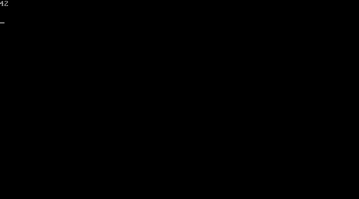

# kfs-1

A minimal i386 kernel for the 42 project KFS_1 ("Grub, boot and screen"). GRUB boots it and it prints `42` on the screen.

The design and the reasons behind each choice are in [docs/DESIGN.md](docs/DESIGN.md).

## Dependencies

The kernel is built on Debian or Ubuntu, x86_64:

```sh
sudo apt install make nasm gcc gcc-multilib grub-pc-bin grub-common xorriso mtools qemu-system-x86
```

| Package | Used for |
|---|---|
| `nasm` | assembling the boot code |
| `gcc`, `gcc-multilib` | compiling 32-bit C |
| `grub-pc-bin`, `grub-common`, `xorriso`, `mtools` | building the bootable ISO with `grub-mkrescue` |
| `qemu-system-x86` | running the kernel |

## Build and run

| Command | Effect |
|---|---|
| `make` | Compile and link `build/kernel.bin` |
| `make iso` | Build the bootable image `build/kfs.iso` |
| `make run` | Boot the ISO in QEMU, with the emulated screen drawn as text in the terminal |
| `make clean` | Remove object files |
| `make fclean` | Remove all build output |
| `make re` | Rebuild from scratch |

To leave `make run`, press `Esc` then `2` to reach the QEMU monitor, type `quit` and press Enter.

To open a graphical window instead: `qemu-system-i386 -cdrom build/kfs.iso`.

`CC`, `LD` and `AS` can be overridden, for example `make CC=i686-elf-gcc LD=i686-elf-ld`.

## How it boots

1. The firmware starts GRUB from the ISO.
2. GRUB reads `grub.cfg` and loads `/boot/kernel.bin`. It recognises the kernel by the Multiboot 1 header (magic `0x1BADB002`) that `linker.ld` places at the very start of the binary.
3. GRUB puts the kernel at 1 MiB, switches the CPU to 32-bit protected mode and jumps to `_start` in `src/boot.s`.
4. `_start` points the stack pointer at the kernel's own 16 KiB stack and calls `kmain`.
5. `kmain` in `src/kernel.c` clears the screen and writes `42` through the screen module.
6. `kmain` returns, and `_start` disables interrupts and halts the CPU in a loop.

## Layout

```
Makefile
linker.ld        places the Multiboot header first, kernel at 1 MiB
grub.cfg         one menu entry: multiboot /boot/kernel.bin
src/
  boot.s         Multiboot header, stack, _start
  kernel.c       kmain
  vga.c          screen: clear, put character, write string
lib/
  string.c       strlen, strcmp, memset, memcpy
include/
  types.h        fixed-width integer types, size_t
  vga.h
  string.h
docs/
  DESIGN.md
```

## The screen

In VGA text mode the screen is 80 columns by 25 rows, stored as an array of 16-bit cells at physical address `0xB8000`. The low byte of a cell is the character and the high byte is its colour. Writing to that memory is all it takes to display text, so `src/vga.c` needs no driver setup.

## Compiler flags

```
-m32 -std=gnu99 -ffreestanding -fno-builtin -fno-stack-protector -fno-pie -nostdlib -nodefaultlibs -Wall -Wextra -Werror
```

The kernel is linked with `ld -m elf_i386 -T linker.ld -nostdlib`, so no host library and no host linker script is involved.

## Proof of boot

The ISO booted in QEMU:


